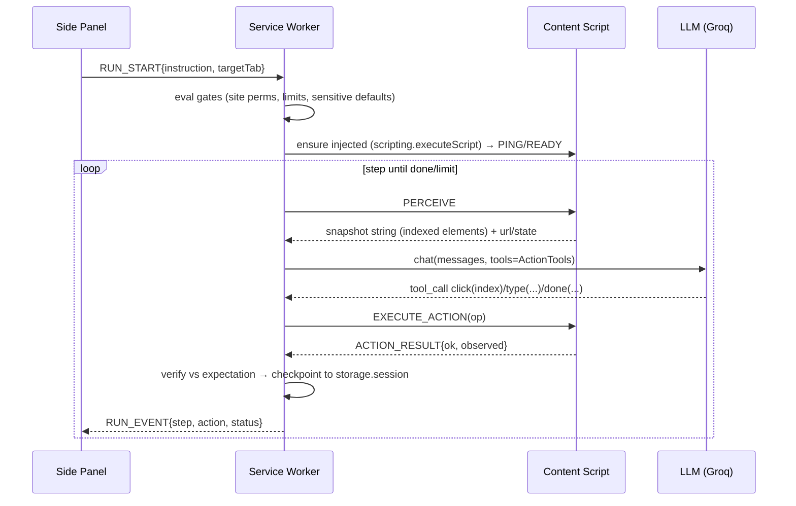

# 02 — Architecture

## 2.1 Processes and responsibilities

MV3 gives us five execution contexts. Ownership is strict — no feature is implemented twice.

```
┌─────────────────────────────────────────────────────────────────────┐
│                     Service Worker (background)                     │
│  The ONLY orchestrator. Owns: run state machine, LLM calls,         │
│  tab/window management, recorder sessions, alarms, permissions,    │
│  approvals, checkpointing. No DOM access. Can be killed at any     │
│  moment — every write goes to durable storage before it matters.   │
├─────────────────────────────────────────────────────────────────────┤
│  Content Script (per tab, registered on demand)                    │
│  Perception: DOM → indexed element snapshot.                       │
│  Action: click/type/select/scroll/keys + result reporting.         │
│  Recorder: capture-phase listener stream.                          │
│  Overlay: highlight ring, status chip, pick-targets checkboxes.    │
├─────────────────────────────────────────────────────────────────────┤
│  Offscreen Document (1, long-lived)                                │
│  Keep-alive heartbeat (messages reset the SW idle timer).          │
│  Heavy DOM-dependent work that must not touch pages.               │
├─────────────────────────────────────────────────────────────────────┤
│  Side Panel (React)                                                │
│  All user surface: chat/launcher, live run view, library, editor,  │
│  settings, approvals. Opens ports to SW for streaming events.      │
├─────────────────────────────────────────────────────────────────────┤
│  Popup = thin launcher only (open panel, quick actions)            │
└─────────────────────────────────────────────────────────────────────┘
Storage layer (shared via SW only):
  chrome.storage.local  → settings, API keys, per-site grants
  IndexedDB (db "tba")  → workflows, runs, run logs (durable)
  chrome.storage.session→ in-flight run state (checkpoint, survives SW death, not restart)
  chrome.storage.sync   → settings only, minus secrets (OFF — see 10-security)
```

## 2.2 Module map (target file tree)

```
src/
  background/            # service worker entry: listener registration only
    index.ts
    run-manager.ts       # run state machine + step orchestration
    run-store.ts         # checkpointing: session storage <-> IndexedDB promotion
    keepalive.ts         # offscreen doc lifecycle + alarm fallback + ports
    tab-manager.ts       # acquire target tab; dedicated-window mode; spotlight
    recorder-service.ts  # recording session state, buffering, compile trigger
    bg-llm.ts            # provider instantiation from settings; per-role models
    permissions.ts       # per-site host permission grants/requests
    approval.ts          # gate evaluation + browser notifications
  content/
    index.ts             # bootstrap; answers PING; injects submodules
    perception/snapshot.ts      # DOM → IndexedElement[] (string wire format)
    perception/visibility.ts
    actions/executor.ts  # dispatch action op → DOM events
    actions/cdp.ts       # chrome.debugger trusted input fallback path
    actions/wait-for.ts  # MutationObserver waits
    recorder.ts          # capture-phase pointer/key listeners
    overlay.ts           # highlight ring, status chip, checkbox layer
  llm/
    types.ts             # LLMProvider interface, Message, ToolCall
    openai-compatible.ts # SSE streaming client (Groq/OpenAI/Ollama/OpenRouter)
    tools.ts             # ActionTool JSON schemas
    prompts/             # planner.ts, generalizer.ts, step-executor.ts
    backoff.ts
  core/                  # isomorphic, imported everywhere
    types/               # workflow.ts run.ts perception.ts settings.ts message
    schema/              # zod runtime validators (single source of truth)
    id.ts  log.ts
  sidepanel/
    main.tsx  App.tsx    # routes: Chat | Library | Editor | Runs | Settings
    store/*.ts           # zustand slices backed by SW subscriptions
    components/…
  offscreen/offscreen.ts
  popup/                 # thin launcher
wxt.config.ts  package.json  tsconfig.json
```

## 2.3 How the pieces talk

- Everything routes **through the service worker**. Content scripts never talk to the side panel
  directly; the SW is the single bus (prevents state divergence when SW restarts).
- Long-lived **ports** (`chrome.runtime.connect`) for streaming: panel ⇄ SW run events,
  Sw ⇄ content run channel, offscreen ⇄ SW keep-alive port.
- One-shot `chrome.runtime.sendMessage` for commands. Full contract: [04-message-protocol.md](04-message-protocol.md).
- LLM calls happen **only in the SW** via `fetch`. The API key lives in `chrome.storage.local`,
  never in page contexts or panel bundles.

## 2.4 Request lifecycle — ad-hoc run



Details of the loop, parallel guarantees and pause/stop semantics: [07-run-loop.md](07-run-loop.md).

## 2.5 Target tab discipline (dedicated window mode)

- Default target = current tab. Optional mode: materialize a **dedicated (minimizable) window**
  for automation so user browsing is untouched (`chrome.windows.create({focused:false})`).
- The SW resolves the run's tabId once per step (tabs can be discarded and re-created — store
  `tabId` + `url` + workflow-resume state so a replace of the tab can recover).
- Never steal focus: no `focus()` calls; overlays only; optional `chrome.action.setBadgeText` "●"
  during runs (PRD §7.2).

## 2.6 Failure containment

- A killed SW mid-run ⇒ nothing is lost: last checkpoint in `storage.session` reconstructs
  `RunState`; alarms wake the SW to resume (§07).
- A dead tab (closed/discarded) ⇒ tab-manager detects and either reloads (allowed) or pauses the
  run and asks the user.
- An unresponsive content script (pending > 10s) ⇒ retry once via `chrome.scripting`, then classify
  step failed with reasons the panel can render per PRD §8 ("what it tried, what it saw").
